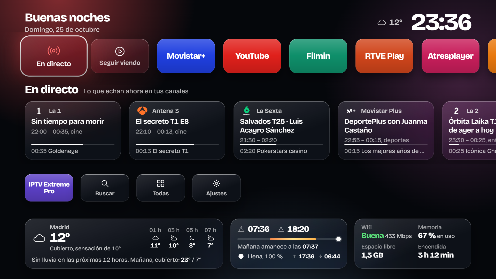

# Inicio para Android TV

Una pantalla de inicio propia para cajas Android TV, sin anuncios ni recomendaciones de nadie. La hice para la Xiaomi Mi Box 4 del salón de casa porque la de Google se había convertido en un escaparate: banners de series que no veo, filas que no puedo quitar y mis apps escondidas debajo de todo.

Lo que hace:

- **Tus apps, en tu orden**, y nada más.
- **Lo que echan ahora** en tus canales de televisión, con el logo de cada uno, y avisos para el programa que no te quieres perder.
- **Seguir viendo**: lo último que viste en cada app, juntado en una sola fila.
- **El tiempo** de tu ciudad, la salida y puesta del sol y la fase de la luna.
- **Un salvapantallas** con la hora, el tiempo y tus canales.
- **El móvil como mando**, sin instalar nada: escaneas un QR en la tele y listo.
- **Instalar apps** desde un pendrive o enviándolas desde el móvil.
- **Temporizador** de apagado y avisos automáticos cuando echen tu equipo o tu serie.
- **Un panel en el PC** (opcional) para ver la pantalla de la tele, manejarla con el teclado e instalar o desactivar apps.

La guía de televisión es de canales de España.

## Manuales

Están también como página web, con el mismo diseño: **[1974julgebass.github.io/tvbox_customize](https://1974julgebass.github.io/tvbox_customize/)**

1. [Instalación](docs/manuales/01-instalacion.md): preparar la caja y el PC, instalar la app y darle los permisos.
2. [Configuración](docs/manuales/02-configuracion.md): tus apps, la ciudad, los avisos, el móvil y el salvapantallas.
3. [Uso](docs/manuales/03-uso.md): el día a día con el mando.

## Descarga

El APK listo para instalar está en [Releases](https://github.com/1974julgebass/tvbox_customize/releases). Si prefieres compilarlo tú, el manual de instalación explica cómo.

## Requisitos

- Caja o tele con Android TV 8 o posterior. Probado en una Xiaomi Mi Box 4 (Android TV 9).
- Un PC para la instalación. Después ya no hace falta: la caja funciona sola.

No necesita root y todo se puede deshacer.

## Qué hay en cada carpeta

| Carpeta | Qué es |
|---|---|
| `launcher/` | La interfaz de la pantalla de inicio, el salvapantallas y el mando del móvil (HTML, CSS y JavaScript). Se puede abrir en el navegador del PC con datos de muestra: las flechas hacen de mando. |
| `android/` | La app Android que la envuelve: pantalla de inicio, permisos, guía, avisos, salvapantallas y el servidor del mando del móvil. |
| `index.php`, `api/`, `includes/`, `css/`, `js/` | El panel opcional para el PC (PHP 8 y ADB). |
| `docs/` | Los manuales, en Markdown y en HTML. |
| `herramientas/` | El script que genera las páginas HTML de los manuales. |

## Licencia

[MIT](https://github.com/1974julgebass/tvbox_customize/blob/main/LICENSE). Úsalo, cámbialo y compártelo como quieras; solo mantén el aviso de la licencia.

## Créditos

- Guía de televisión y logos de canales: [EPG_dobleM](https://github.com/davidmuma/EPG_dobleM). La app los descarga de su repositorio; no van incluidos aquí.
- Tiempo y búsqueda de ciudades: [Open-Meteo](https://open-meteo.com/).
- Generador de códigos QR: [qrcode-generator](https://github.com/kazuhikoarase/qrcode-generator), de Kazuhiko Arase (MIT).
- Cálculos de la luna: basados en [SunCalc](https://github.com/mourner/suncalc), de Vladimir Agafonkin (BSD-2).
- Cliente ADB de la app: [dadb](https://github.com/mobile-dev-inc/dadb), de mobile.dev (Apache 2.0).
- Tipografía: [Bricolage Grotesque](https://github.com/ateliertriay/bricolage) (SIL Open Font License 1.1).
