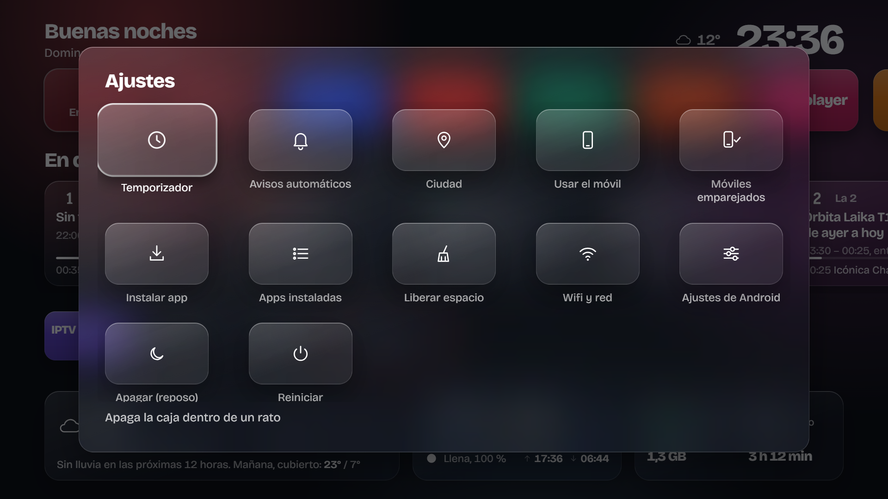
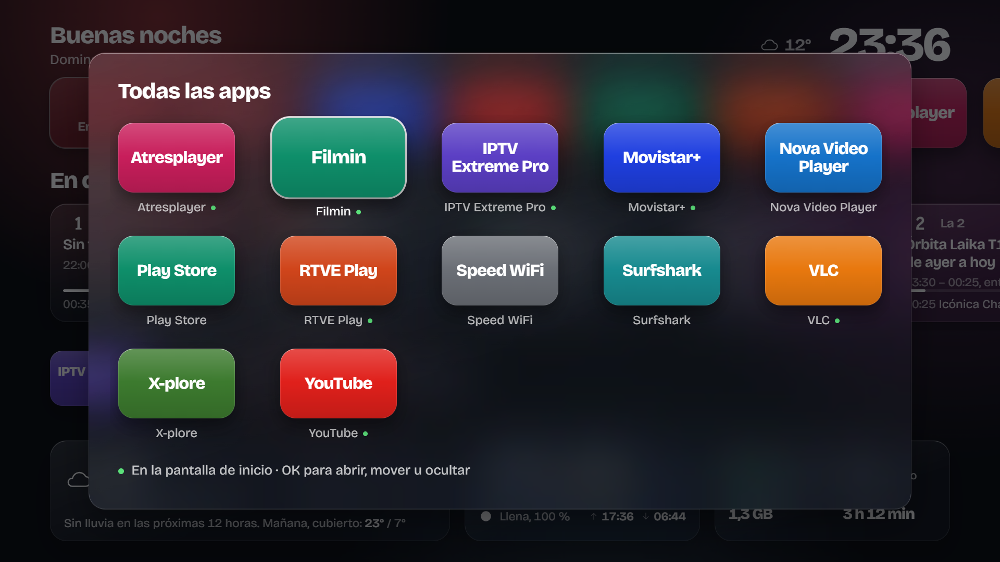
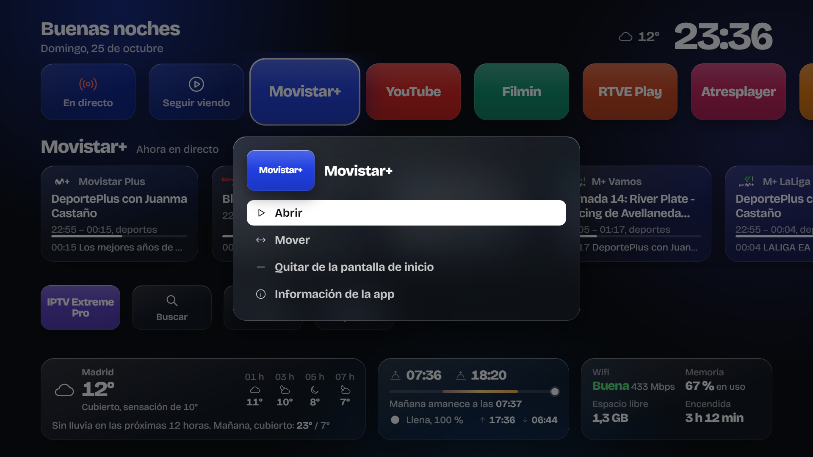
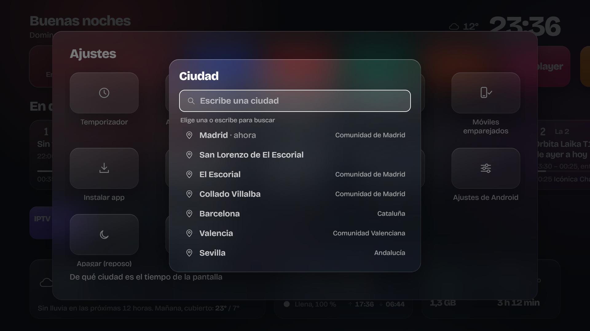
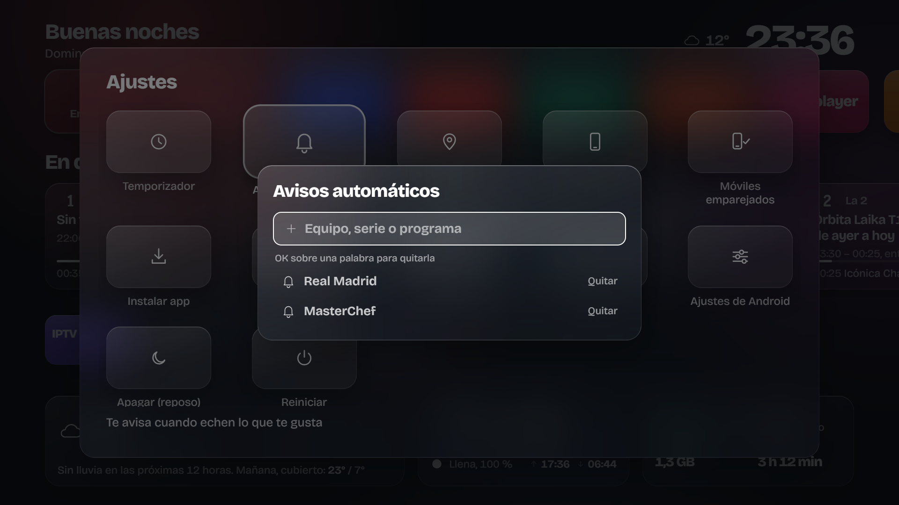
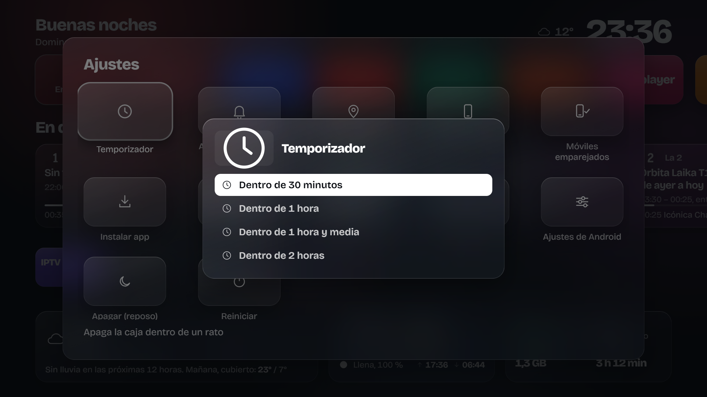
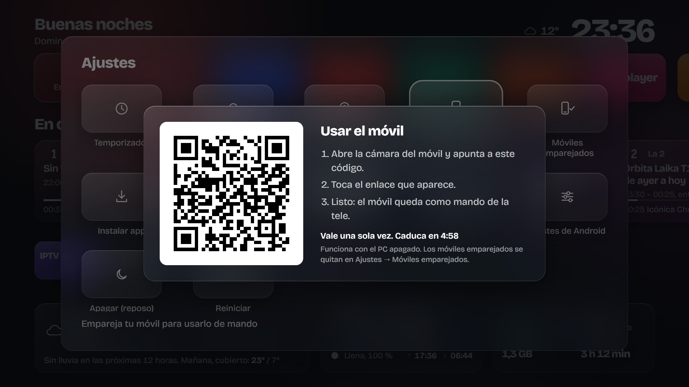
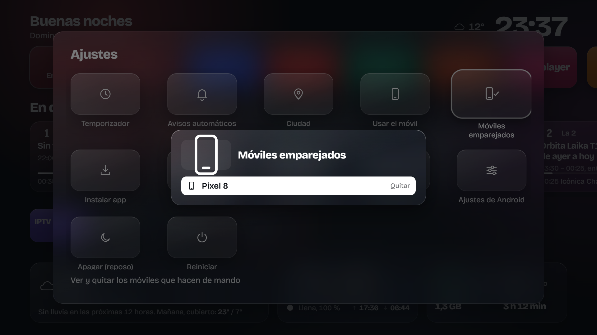
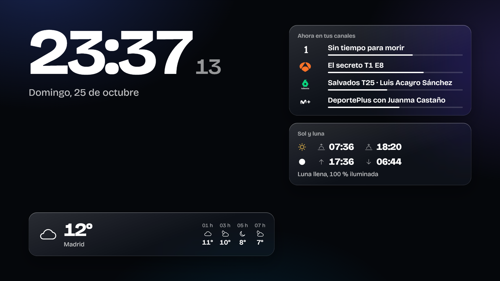

# Setup

Once the app is installed and set as your home screen (see the [installation manual](01-installation.md)), it's time to make it yours. Almost everything is done from the TV itself with the remote, in **Ajustes** (Settings), the last card on the third row.



Below the icons there's a line explaining what the highlighted setting does. Power off and restart sit at the end on purpose, so nobody presses them by accident.

## Your apps on the home screen

The screen doesn't show every app: it shows the ones you choose. To add one:

1. Open **Todas** (All apps).
2. Move to the one you want and press **OK**.
3. Choose **Añadir a la pantalla de inicio** (Add to home screen).



Apps that are already on the home screen have a green dot next to their name.

You decide which apps appear; the screen decides where. Apps with something to tell you go up to the first row: TV apps (RTVE Play, Atresplayer, Movistar+), because they show their guide, and apps that keep track of what you last watched. The rest stay on the third row, next to Buscar (Search), Todas (All) and Ajustes (Settings).

On any app on the home screen, **OK** opens its menu:



- **Abrir** (Open): it's already highlighted, so opening an app is OK, OK.
- **Mover** (Move): the app lifts up and you move it with the left and right arrows. OK to drop it.
- **Quitar de la pantalla de inicio** (Remove from home screen): it disappears from here but stays installed.
- **Información de la app** (App info): opens its Android page, to force stop it, clear its data or uninstall it.

From **Todas** (All apps) you can also **Ocultar** (Hide) an app you never use and can't uninstall (the ones that come preinstalled). It moves to the end of the list, greyed out, and you can get it back from there with **Volver a mostrar** (Show again).

## Weather city

**Ajustes → Ciudad** (Settings → City). Type the name with the TV keyboard (or the remote's microphone, if it has one) and pick yours from the list. It searches Spain first, but any city in the world works.



The weather, sunrise and sunset, and the moon's times switch to that city, in its local time.

## Automatic reminders

If you follow a team or a show, add it here and the box will let you know when it's on one of your channels.

**Ajustes → Avisos automáticos** (Settings → Automatic reminders). Press OK on the text box, type the word and press OK again. To remove one, move onto it and press OK.



How it works:

- It searches the guide for the channels of the TV apps you have installed.
- Accents and capital letters don't matter.
- It checks the guide every six hours, even if you never open the home screen.
- One minute before it starts, a card pops up in a corner of the screen, whatever you're watching.

Use specific words. "Madrid" will alert you to every news bulletin; "Real Madrid" only to the matches.

## Sleep timer

**Ajustes → Temporizador** (Settings → Timer) turns the box off in 30 minutes, 1 hour, 1 and a half hours or 2 hours. While it's running, an orange pill next to the clock shows the time left.



It warns you on screen one minute before. If you want to keep watching, go back to **Temporizador** and choose **Cancelar temporizador** (Cancel timer).

"Off" here means standby, the same as the remote's power button. The remote turns it back on.

## Using your phone as a remote

Any phone in the house can be a remote: D-pad, volume, typing with the phone's keyboard (much easier for searches or passwords), opening apps and installing APKs. There's nothing to install on the phone: it's a web page served by the box itself.

1. On the TV, **Ajustes → Usar el móvil** (Settings → Use your phone). A QR code appears.
2. Open it with the phone's camera and tap the link.
3. Done. Add the page to your phone's home screen to keep it handy.



The code works once and expires after five minutes. The phone stays paired until you remove it.

**The first time** you use the phone remote, the TV will ask **"Allow USB debugging?"**. That's the box asking itself for permission to press keys. Tick *Always allow* and accept; it won't come up again.

To see which phones are paired, or remove one (a visitor's, say), go to **Ajustes → Móviles emparejados** (Settings → Paired phones) and press OK on it.



Two things to bear in mind:

- The phone has to be on the same Wi-Fi as the box.
- When the box goes into standby its Wi-Fi turns off, so the phone can't wake it. Use the regular remote for that.

## Screensaver

If you granted the screensaver permission during installation, when the box has been idle for a while a screen appears with a large clock, the weather, what's on your channels, the moon, and any reminders you have pending.



It shifts a few pixels every minute so it doesn't mark the screen. You choose how long it takes to start in Android's settings (**Ajustes → Ajustes de Android → Device Preferences → Screen saver**) or from the PC panel.

## Night mode

From 11 pm to 7 am the screen dims a little so it doesn't dazzle you with the lights off. It turns on by itself; there's nothing to set up.

## Guide channels

The TV guide comes from [EPG_dobleM](https://github.com/davidmuma/EPG_dobleM)'s public listings, which cover Spanish channels. The box downloads it every six hours.

Each TV app has its channels assigned in `launcher/js/home.js`, at the top of the file:

```js
const CANALES = {
  'com.rtve.androidtv': ['La 1 HD', 'La 2', '24 Horas', 'Clan', 'Teledeporte'],
  'com.antena3.atresplayer.tv': ['Antena 3 HD', 'La Sexta HD', 'Neox', 'Nova', 'Mega', 'Atreseries'],
  ...
};
```

The **En directo** (Live) card gathers the ones in `PRINCIPALES`, in that order. If you want other channels, change them there (using the exact name the guide uses), then build and install again.

Atresplayer opens the chosen channel live. RTVE Play and Movistar+ open the app without going to the channel: I haven't found a way to ask them for a specific channel from outside. The first time you open an Atresplayer live channel, the app will ask you to accept its cookies.

## From the PC panel

If you set up the panel, its **Ajustes** section lets you change three Android settings that are more hidden on the TV:

- **Animaciones** (Animations): faster or off. On a modest box, 0.5× feels snappier.
- **Salvapantallas** (Screensaver): how long before it starts.
- **Suspensión** (Sleep): how long without use before the box turns off.

## Cleaning up the factory apps (optional)

Boxes usually come with advertising, analytics and recommendation apps that add nothing. You can disable them from the PC without uninstalling anything, so you can always go back. These are the ones I disabled on the Mi Box 4:

```powershell
adb shell pm disable-user --user 0 tv.alphonso.alphonso_eula
adb shell pm disable-user --user 0 com.miui.tv.analytics
adb shell pm disable-user --user 0 com.mitv.tvhome.michannel
adb shell pm disable-user --user 0 com.google.android.tvrecommendations
adb shell pm disable-user --user 0 com.google.android.feedback
adb shell pm disable-user --user 0 com.google.android.tv.bugreportsender
```

To bring one back: `adb shell pm enable <package>`.

Don't touch Google's services (`com.google.android.gms`, `com.google.android.gsf`, `com.android.vending`), `com.google.android.tungsten.setupwraith` (it can wipe your saved Wi-Fi), or anything to do with the remote or Chromecast. If you're unsure about a package, leave it alone.
