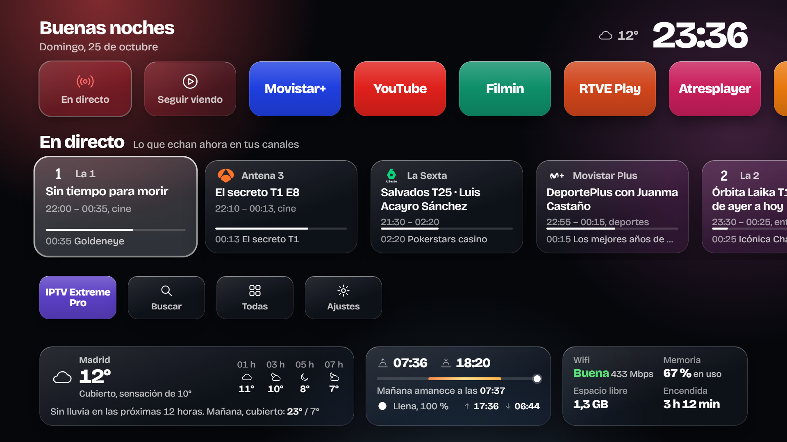
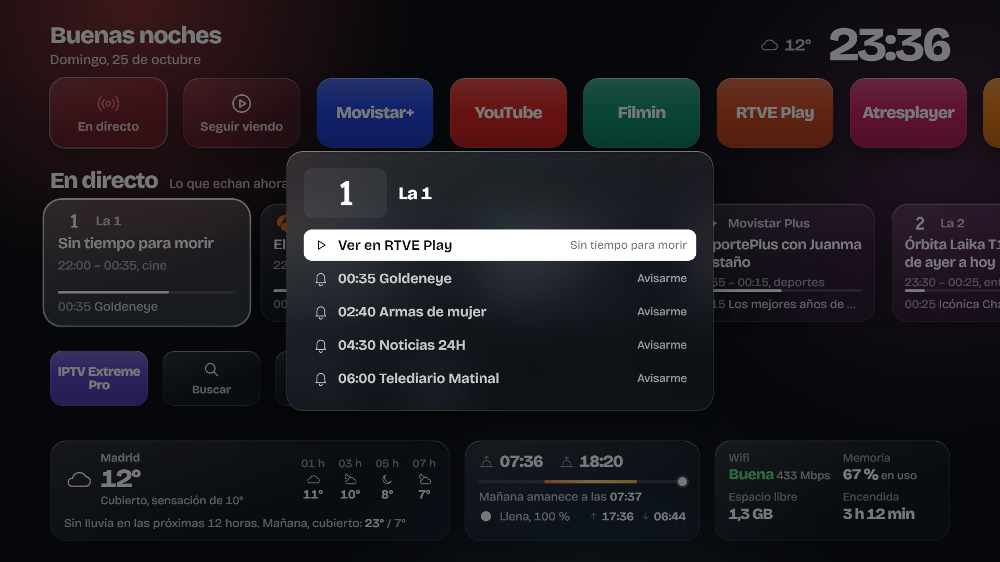
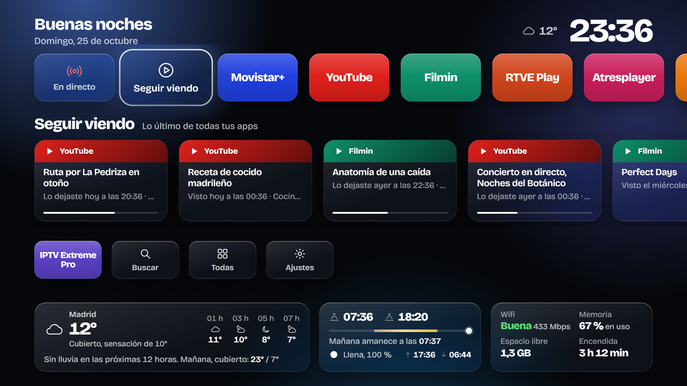
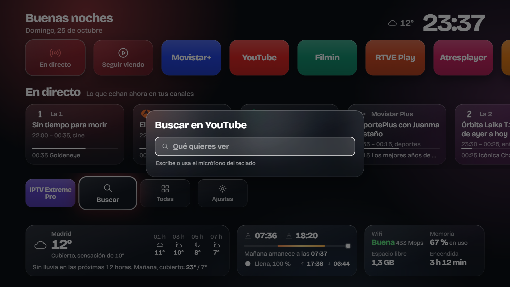
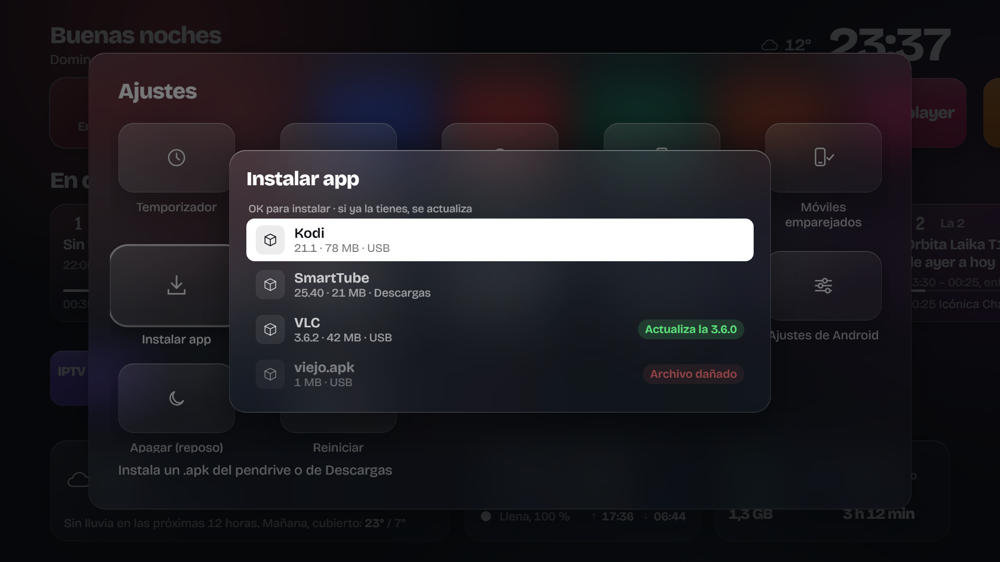
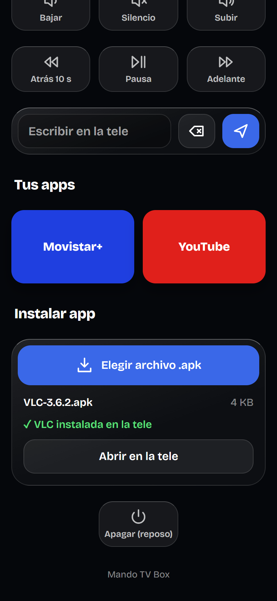
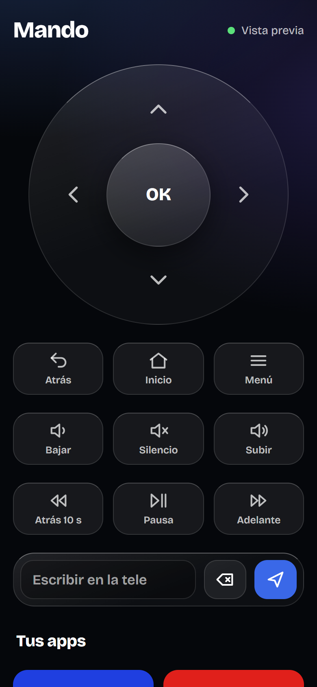
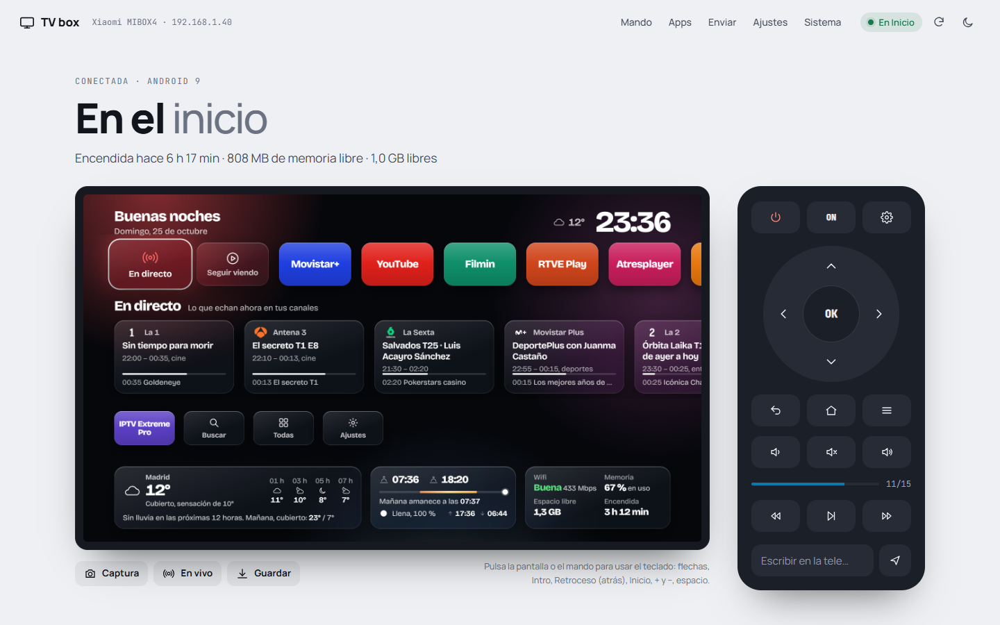
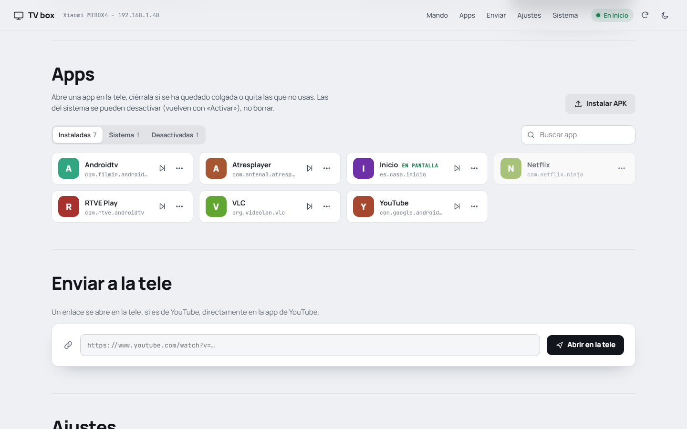

# Usage

This part is for whoever uses the TV every day, not for whoever set it up. Everything works with the remote: the arrows, **OK**, **Back** and **Home**. If the remote has a **☰** button, that works too.

## The home screen

It has four parts, from top to bottom:

1. **Your apps with something to tell you.** The first card, **En directo** (Live), gathers what's on now across your channels. Then **Seguir viendo** (Continue watching) and your TV or video apps.
2. **What belongs to the highlighted app.** It changes as you move along the row above: its channels' guide, or the last thing you watched with it.
3. **The rest of your apps**, plus **Buscar** (Search), **Todas** (All) and **Ajustes** (Settings).
4. **The weather, the sun and moon, and how the box is doing** (Wi-Fi, memory and free space).

The background takes on the colour of the app you've highlighted. When you turn it on, the screen lands on the last app you used.

**Back** never takes you away from here: on the home screen it returns you to the first card.

## Opening an app

Move onto it and press **OK**. A small menu opens with **Abrir** (Open) already highlighted: press **OK** again.

That menu also lets you move it, remove it from the screen or see its info. While the app starts you'll see its colour and its name full screen.

## Watching live TV

Move onto **En directo** (or RTVE Play, Atresplayer or Movistar+) and go down with the arrow. Each card is a channel: what's on now, when it ends, how far along it is, and what comes next.

Press **OK** on a channel:

- The first option opens it in its app.
- Below it you'll see the next four shows. **OK** on one and you'll get a reminder a minute before it starts. It shows a bell; another OK removes the reminder.

The reminder pops up in a corner even if you're watching something else, and goes away by itself after twenty seconds.

## Continue watching

The **Seguir viendo** card gathers the last thing you watched across all your apps, most recent first. If you left something halfway, the bar shows how much is left.

Press **OK** on one and its app opens. Apps don't let another app send you to the exact minute, so once inside you'll have to pick it; most of them put it first in their own "continue watching".

## Searching YouTube

On the third row, **Buscar** (Search). Type with the TV keyboard or use the microphone and press **OK**: YouTube opens with the results. Your latest searches stay underneath, to repeat them with one OK.

## All apps

**Todas** (All) shows every installed app, 15 at a time. Going past the last row jumps to the next page; the bottom right says which page you're on.

## Installing an app

**From the TV:** copy the `.apk` file to a USB stick and plug it into the box (or download it to the Downloads folder). Then **Ajustes → Instalar app** (Settings → Install app).

You'll see every `.apk` it finds, with its name, version, size and where it came from. If you already have the app, it tells you: «Ya la tienes» (you already have it), «Actualiza la 3.6.0» (updates 3.6.0) or «Tienes una más nueva» (you have a newer one). Press **OK** and it installs, no more questions. When it's done you can open it right there.

**From your phone:** in the phone remote, **Instalar app → Elegir archivo .apk** (Install app → Choose .apk file). You'll see it upload and install; meanwhile a card appears on the TV. A 100 MB file takes about a minute, almost all of it spent going over the Wi-Fi.

The first time, Android may show a Google Play Protect prompt on the TV to scan the app. You have to accept that one yourself.

## Your phone as a remote

If your phone is paired (the setup manual explains how), open the remote page and you get:

- The D-pad with **OK**, plus **Atrás** (Back), **Inicio** (Home) and **Menú** (Menu).
- Volume and mute, and rewind, pause and fast-forward.
- **Escribir en la tele** (Type on the TV): whatever you type on the phone appears in whichever text field is open on the TV. Accented letters and ñ become plain letters, because Android doesn't let you type them that way.
- **Tus apps** (Your apps): tap one and it opens on the TV.
- **Instalar app** (Install app).
- **Apagar (reposo)** (Power off, standby).

The top right shows whether the phone is connected to the TV.

## Power off, restart and the sleep timer

In **Ajustes** (Settings), at the end:

- **Apagar (reposo)** turns off the screen and puts the box to sleep. The remote turns it back on.
- **Reiniciar** (Restart) opens Android's power button menu, where you'll find the restart option.
- **Temporizador** (Timer) turns it off after a while. While it counts down, you'll see an orange pill next to the clock.

## If something's not working

**The guide says «No se ha podido cargar» (couldn't load).** The box has no internet right now. Check the Wi-Fi in **Ajustes → Wifi y red**; the guide tries again when you come back to that app.

**An app doesn't appear on the home screen.** Find it in **Todas** and add it with **OK → Añadir a la pantalla de inicio**. If it isn't there either, you may have hidden it: it'll be at the end of the list, greyed out.

**The phone says «No llego a la tele» (can't reach the TV).** The box is in standby, or the phone isn't on the same Wi-Fi.

**It's slow.** Free up space in **Ajustes → Liberar espacio** (Free up space). If space runs very low, the screen itself warns you once a day.

## The PC panel

If someone at home set up the computer panel, from there you can see the TV screen and control it with the keyboard or with the remote drawn next to it. The arrows are the arrows, Enter is OK, Backspace is Back and the space bar pauses.

Further down are the apps (open, close, disable and install APKs), a box to send links to the TV (YouTube links open in the YouTube app), Android's settings and the box's status.

